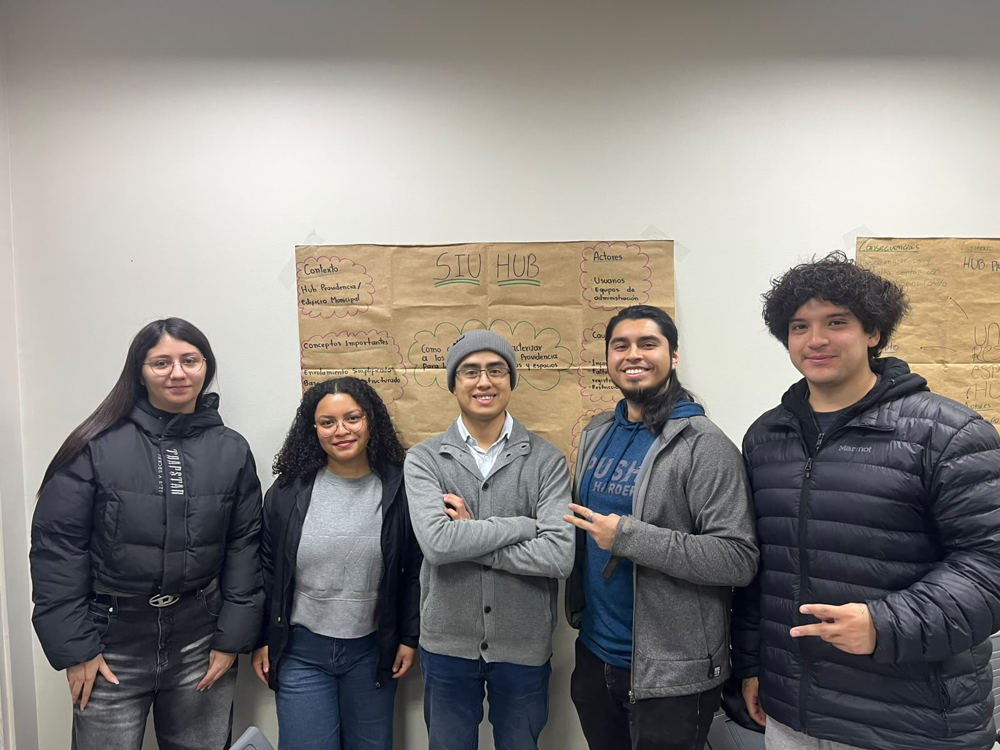

# Desafío 01 | Edificios Inteligentes

## Capstone Intermedio 2026
**Equipo:** S.I.U HUB  
**Desafío:** Caracterización de usuarios del Hub Providencia  
**Contraparte:** Municipalidad de Providencia / Hub Providencia  
**Estado actual:** En desarrollo

## Descripción
**Desafío Hub Providencia - Edificios Inteligentes**  
Solución tecnológica para registrar, caracterizar y analizar el flujo de usuarios en Hub Providencia. Incluye un sistema de registro, base de datos estructurada y un dashboard analítico para optimizar la gestión del espacio.

**Propuesta seleccionada (octubre 2026):** aplicación web de enrolamiento único con código QR, que registra entrada y salida y centraliza en una sola base los datos que hoy se reparten entre Luma, BIForm, planillas Excel y un cuaderno en papel.

## Equipo
| Integrante | Carrera o especialidad | Rol  | Usuario de GitHub |
|---|---|---|---|
| Amanda Parraguez | Ing. Civil Industrial | Lider de proyecto  | [@amandaparraguez-blip](https://github.com/amandaparraguez-blip) |
| Benjamín Oliva | Ing. Civil en computación e Informática | Desarrollo web y dashboard | [@bnj-92](https://github.com/bnj-92) |
| Gerzon Toro | Ing. Civil en computación e Informática | Coordinación técnica y backend | [@gerzontoro](https://github.com/gerzontoro) |
| Josué Villa | Ing. Civil Electrónica | Desarrollo e integración | [@jvilla-02](https://github.com/jvilla-02) |
| Valentina Zapata | Ing. Civil Industrial | Diseño y experiencia de usuario | [@valentinazapatat-beep](https://github.com/valentinazapatat-beep) |

## Valores del equipo
- Compromiso y responsabilidad
- Comunicación transparente
- Proactividad y trabajo en equipo

## Normas de funcionamiento
1. Asistir puntualmente a las reuniones y sesiones programadas.
2. Avisar con anticipación en caso de imprevistos o ausencias.
3. Actualizar la bitácora en GitHub al finalizar cada sesión.
4. **Desacuerdos:** Se resolverán mediante conversación, votación o mediación del equipo docente.
5. **Decisiones:** Toda decisión clave quedará registrada formalmente en la bitácora.

## Desafío inicial
¿Cómo podríamos cuantificar y caracterizar a los usuarios del edificio del Hub Providencia para apoyar la gestión y la toma de decisiones?

### Lo que sabemos
- El Hub Providencia recibe a emprendedores, startups, estudiantes, vecinos y visitantes.
- Existe información limitada sobre la frecuencia de uso, espacios ocupados y comportamiento de los visitantes.
- El registro de ingreso se realiza mediante un formulario de Google que solicita
  nueve campos y debe completarse en cada visita.
- El formulario no permite reconocer a una persona que ya visitó el edificio ni
  registra su salida.
- Las áreas especiales se autorizan por correo, la sala de reuniones se agenda en
  recepción y las charlas usan un registro aparte.
- Circulan entre 200 y 300 personas en el edificio, con mayor afluencia entre las
  9:00 y las 14:00 y los días martes y jueves.
- El Hub realiza cerca de 10 charlas semanales, con unas 50 personas promedio por
  charla y hasta 150 en las de mayor convocatoria.
- El registro ocurre hoy en al menos cuatro formatos distintos: Luma, BIForm o
  BukForm, planillas Excel y un cuaderno en papel del segundo piso.
- Ninguna de esas modalidades registra la salida de las personas.
- El Hub quiere caracterizar a sus usuarios por nivel educacional, edad, comuna,
  situación laboral y sector.
- Rory es el encargado de los datos y busca mantener el registro en un solo lugar.

### Lo que todavía no sabemos
- Cuántos usuarios nuevos vs. recurrentes visitan el edificio. No existe la cifra.
- Cuál es el tiempo de permanencia de las personas en el edificio.
- Si las 200 a 300 personas son simultáneas o acumuladas durante el día.
- Cuántas personas entran sin registrarse.
- Si el Hub autorizará instalar un dispositivo de escaneo en recepción.
- Qué política de datos personales aplica la Municipalidad de Providencia.
- Cuál es la situación actual de las cámaras del edificio.

### Lo que el prototipo busca medir
- Cuántos visitantes son nuevos y cuántos recurrentes.
- Cuál es el tiempo de permanencia de las personas en el edificio.
- Cuánto demora registrar a una persona, comparado con el formulario actual.
- Qué proporción de las personas marca su salida.

## Compromisos individuales
| Integrante | Compromiso SMART |
|---|---|
| Amanda Parraguez | Me comprometo a llegar antes de la hora de inicio a las clases y reuniones del equipo durante todo el semestre, avisando el mismo día cuando no pueda, y a cumplir dentro del plazo las tareas que asuma. También me comprometo a reforzar mis conocimientos técnicos para aportar en el desarrollo del prototipo, y no solo en la documentación. |
| Gerzon Toro | Como Desarrollador Backend y Gestor de Base de Datos en el proyecto, me comprometo a diseñar e implementar una arquitectura de base de datos relacional y una API REST eficiente utilizando exclusivamente tecnologías open-source o de costo cero, garantizando la seguridad de la información y tiempos de respuesta inferiores a 200 ms. Seré responsable de conectar el prototipo físico de registro con la base de datos y de desarrollar un sistema de enrolamiento simplificado que automatice la identificación de usuarios recurrentes, entregando el esquema de datos, los endpoints integrados y la optimización final del sistema documentado dentro de los plazos establecidos para los hitos del proyecto. |
| Benjamín Oliva |Me comprometo a asistir puntualmente a las clases, entregar cada actividad y avance del proyecto dentro del plazo fijado y aportar activamente en el trabajo semanal hasta finalizar el semestre.  |
| Josué Villa | Me comprometo a investigar, evaluar y definir la arquitectura de hardware/tecnología de captura de datos (sensores, lectores de identificación o dispositivos de registro) para el prototipo del Hub Providencia, entregando un informe técnico comparativo de al menos 2 alternativas tecnológicas viables y de bajo costo antes de finalizar la semana 3 del proyecto. |
| Valentina Zapata |Me comprometo a participar activamente y asistir puntualmente en todas las clases y reuniones del equipo a lo largo del semestre, cumpliendo a tiempo con todas las tareas asignadas. En el proyecto, asumiré la responsabilidad de modelar y documentar los flujos de interacción y las métricas de permanencia y recurrencia de usuarios, asegurando que la solución responda a los vacíos de información del Hub antes del cierre de cada hito. |

## Usuarios y contexto
Emprendedores, startups, estudiantes, vecinos y visitantes del Hub Providencia, junto con el equipo de gestión del edificio.

## Plan de trabajo

| Actividad | Responsable(s) | Fecha | Estado |
|---|---|---|---|
| Definición de identidad del equipo y roles | Equipo | 24-08-2026 | Completado |
| Elaboración del mapa conceptual del desafío | Equipo | 25-08-2026 | Completado |
| Visita a terreno y levantamiento del proceso actual | Amanda, Gerzon | 25-08-2026 | Completado |
| Delimitación del alcance del proyecto | Equipo | 26-08-2026 | Completado |
| Presentación del pitch del tema | Equipo | 01-09-2026 | Completado |
| Entrega de la ficha del desafío | Equipo | 01-09-2026 | Completado |
| Ejercicio de observación en terreno | Equipo | 08-09-2026 | Completado |
| Estado del arte y matriz de atributos | Equipo | 22-09-2026 | Completado |
| Segunda visita al Hub y levantamiento con la contraparte | Valentina, Josué | 06-10-2026 | Completado |
| Fichas de bosquejo de las tres soluciones | Equipo | 12-10-2026 | Completado |
| Informe de cierre de la Unidad 2 | Equipo | 12-10-2026 | Completado |
| Presentación de las tres propuestas (cierre Unidad 2) | Equipo | 13-10-2026 | En proceso |
| Diseño del modelo de datos | Gerzon | | Pendiente |
| Desarrollo del enrolamiento y generación del QR | Benjamín | | Pendiente |
| Pantalla de escaneo y registro de entrada y salida | Gerzon, Josué | | Pendiente |
| Dashboard de indicadores | Benjamín, Valentina | | Pendiente |
| Definición del punto físico de escaneo en recepción | Josué | | Pendiente |
| Prueba del prototipo en terreno | Equipo | | Pendiente |

## Índice de la bitácora
- [S01 — Semana del 25 de agosto al 1 de septiembre de 2026](bitacora/S01.md)
- [S02 — Semana del 1 al 8 de septiembre de 2026](bitacora/S02.md)
- [S03 — Semana del 8 al 21 de septiembre de 2026](bitacora/S03.md)
- [S04 — Semana del 22 al 28 de septiembre de 2026](bitacora/S04.md)
- [S05 — Semana del 29 de septiembre al 5 de octubre de 2026](bitacora/S05.md)
- [S06 — Semana del 6 al 13 de octubre de 2026](bitacora/S06.md)
- [S07 — Semana del 13 al 20 de octubre de 2026](bitacora/S07.md)

> La S03 abarca dos semanas porque la del 15 al 21 de septiembre correspondió al
> receso de Fiestas Patrias y no hubo sesión.

## Entregables y evidencias
- [Carpeta de evidencias](bitacora/evidencias/)
- [Contrato del equipo](contrato-equipo.docx)
- [Ficha del Desafío 01](bitacora/evidencias/S02/ficha-desafio-01.docx)
- [Actividades del 22 de septiembre: estado del arte, matriz de atributos y lluvia de ideas](bitacora/evidencias/S04/actividades-22-sep.pdf)
- [Fichas de bosquejo de las tres soluciones](bitacora/evidencias/S05/fichas-bosquejo-soluciones.pdf)
- [Informe de cierre de la Unidad 2](bitacora/evidencias/S06/informe-unidad2.pdf)

## Decisiones relevantes
| Fecha | Decisión | Criterio o justificación |
|---|---|---|
| 21-08-2026 | Creación de la estructura base en GitHub | Organización de la bitácora del proyecto Capstone |
| 25-08-2026 | Realizar visita presencial al Hub Providencia | La información pública disponible no detallaba las áreas ni el funcionamiento del edificio |
| 25-08-2026 | Centrar el pitch en el problema y no en la solución | Indicación de la profesora en clase |
| 26-08-2026 | Dejar fuera del alcance el módulo de reservas de espacios | Corresponde al Desafío 02, que aborda la reserva de salas, cowork y laboratorios |
| 26-08-2026 | Dejar fuera del alcance la medición de ocupación en tiempo real mediante sensores | Corresponde al Desafío 03, que mide ocupación y disponibilidad del cowork |
| 26-08-2026 | Mantener en el alcance el registro del área declarada al ingresar | La ficha del Desafío 01 solicita identificar qué espacios ocupan los usuarios, y el formulario actual ya captura ese dato |
| 01-09-2026 | Definir el alcance únicamente según lo que pide la ficha del Desafío 01 | Indicación de la profesora: cada equipo debe concentrarse en su propio desafío y no en evitar superposición con los demás. Deja sin efecto el criterio usado el 26-08 |
| 08-09-2026 | Priorizar el sistema de registro por sobre la reserva de salas | El núcleo del desafío es caracterizar usuarios; las reservas se incorporan solo si el avance lo permite |
| 29-09-2026 | Desarrollar una aplicación web y no una aplicación descargable | Publicar en las tiendas tiene costo anual, el visitante ocasional no instalaría una app y una sola versión web funciona en todos los dispositivos |
| 12-10-2026 | Presentar tres propuestas: aplicación web con QR, sensores de conteo y reconocimiento facial | Son tecnologías de identificación realmente distintas y permiten comparar costo, componentes y factibilidad |
| 12-10-2026 | Descartar "cámaras con IA" como propuesta independiente | Se superpone con el reconocimiento facial en componentes y costos |
| 12-10-2026 | Seleccionar la aplicación web con enrolamiento único como propuesta a desarrollar | Es la única de costo cero, no trata datos biométricos y ataca la dispersión de registros detectada en terreno |

## Próximo hito
*Actualizado al 12 de octubre de 2026*

Cerrar la Unidad 2 con la presentación de las tres propuestas y la entrega del
informe de la propuesta seleccionada. A partir de la Unidad 3, construir el
prototipo de la aplicación web: modelo de datos, enrolamiento, registro de
entrada y salida y dashboard de indicadores.

## Uso y licencia
Por definir con el equipo docente y la contraparte.
