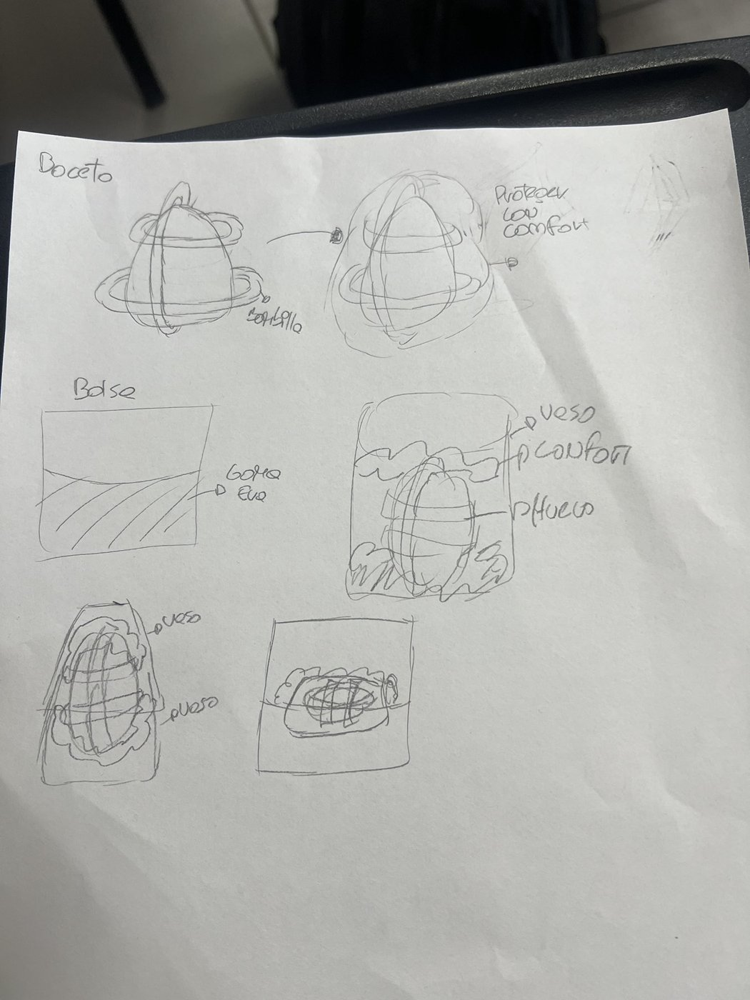
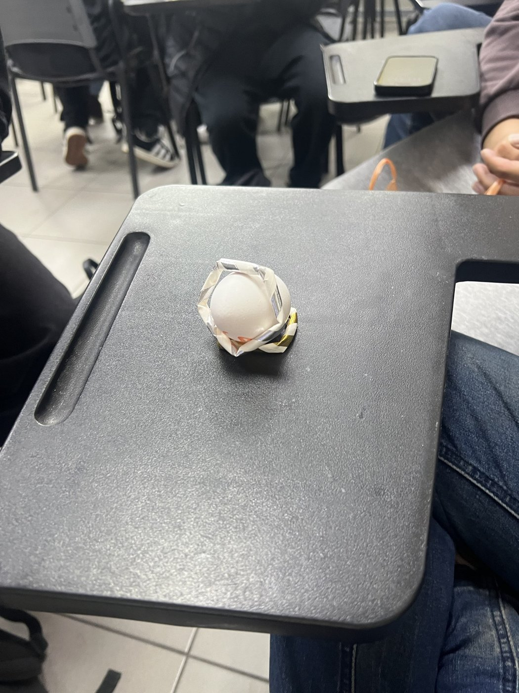
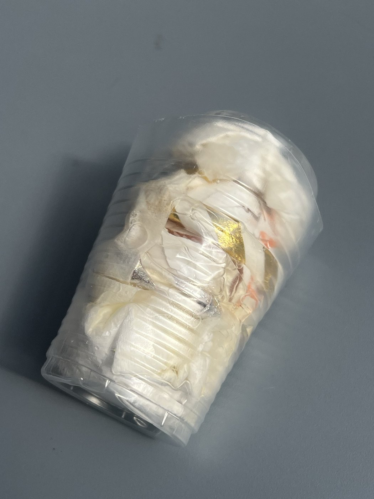
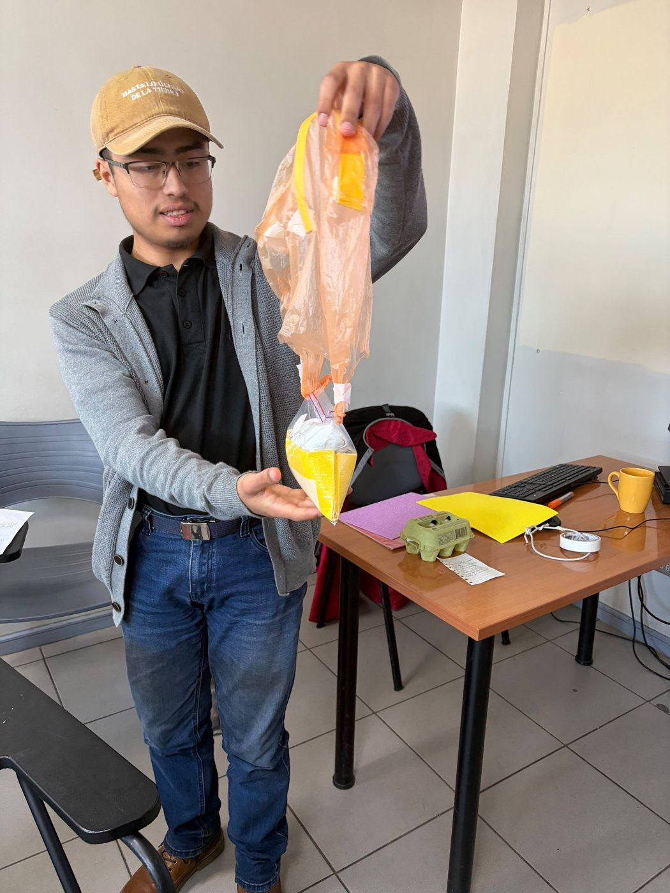
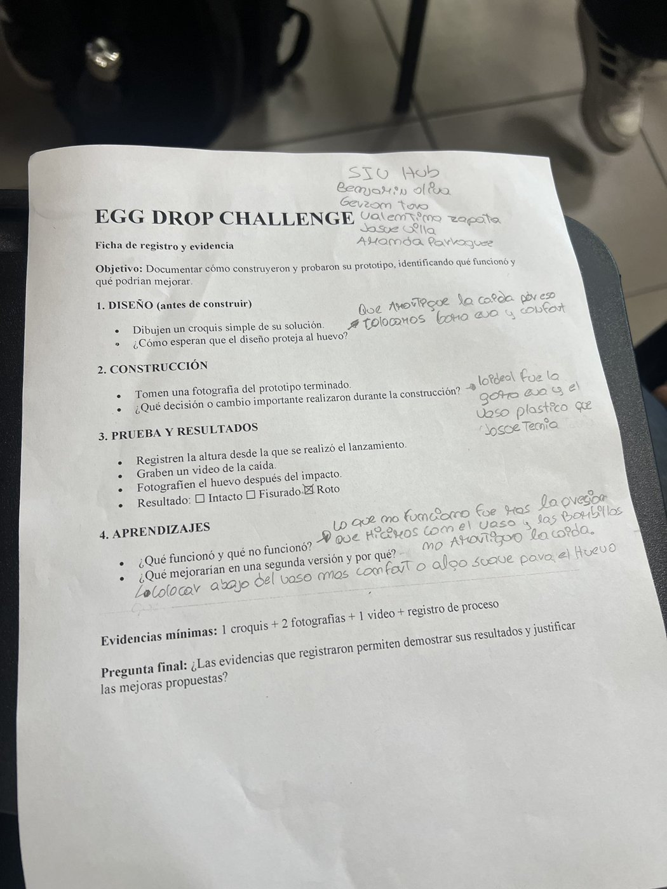

# S10 — Semana del 10 al 17 de noviembre de 2026

## 📅 Fecha
10 de noviembre de 2026

## 🏫 Trabajo realizado en clase

### 📝 Actividades
En esta sesión mostramos a la profesora el avance de la página web de Hub Pass. Estuvo presente todo el equipo.

Luego se realizó una actividad grupal, el **Egg Drop Challenge**: diseñar y construir una protección para que un huevo no se rompiera al dejarlo caer. Participó todo el equipo. El huevo se rompió.

### 📋 Ejercicio en clase — respuestas del equipo

**Egg Drop Challenge**

**¿Cómo esperan que el diseño proteja al huevo?**
Que amortiguara la caída. Por eso pusimos goma eva y confort alrededor del huevo.

**¿Qué decisión o cambio importante realizaron durante la construcción?**
Lo ideal fue usar la goma eva y el vaso plástico que tenía Josué. El huevo quedó envuelto en bombillas y cinta, dentro del vaso con confort, en una bolsa con goma eva y con una bolsa como paracaídas.

**Resultado:** el huevo se rompió.

**¿Qué funcionó y qué no funcionó?**
No funcionó la presión que hicimos con el vaso y las bombillas, que no amortiguaron la caída. Creemos que además le pusimos demasiadas cosas, y el peso hizo que cayera más fuerte.

**¿Qué mejorarían en una segunda versión y por qué?**
Poner más confort o algo suave debajo del vaso para el huevo, y usar menos materiales para que el prototipo sea más liviano.

### 🧠 Aprendizajes
- Agregar más cosas no siempre mejora una solución; puede volverla más pesada y frágil. En Hub Pass eso significa priorizar las funciones indispensables antes que sumar funciones nuevas.
- Hay que probar antes de la prueba final para detectar qué no funciona.

### 📢 Indicaciones de la profesora para la semana
Sobre el avance de la página:
- Incluir a los **menores de edad** en el registro.
- Usar la opción **"En búsqueda laboral"**, que suena más amigable.
- Definir **cómo haremos la validación** del prototipo.

## 🏠 Trabajo realizado fuera de clases

### Acuerdos
**Ajustes a la página según la profesora**
- Se agregó el rango de edad **14 a 17 años (enseñanza media)**. No se permite registrar a menores de 14 (Ley 21.719).
- En "Situación actual" se usa **"En búsqueda laboral"**.
- Se definió el plan de validación: probar el circuito completo (registro, QR, entrada y salida, reserva de sala e indicadores) con usuarios de prueba, y registrar qué funciona, qué falla y cómo se corrige.

## 📌 Avances obtenidos
- Avance de la página presentado a la profesora.
- Menores de 14 a 17 años incluidos en el registro.
- Plan de validación definido.

## ⚠️ Problemas o dificultades
- En el Egg Drop Challenge el huevo se rompió por la presión del vaso y las bombillas y por el exceso de materiales.

## 📌 Tareas pendientes
- Realizar la validación del prototipo.
- Terminar las páginas de recepción y administración.
- Preparar el póster de la Feria Capstone.

## 📷 Evidencias

**Boceto del diseño**

**Construcción: huevo protegido con bombillas y cinta**

**Huevo dentro del vaso con confort**

**Prototipo terminado con paracaídas**

**Ficha de registro del Egg Drop Challenge**

**Video de la caída:** [S10.CaidaHuevo.mov](evidencias/S10.CaidaHuevo.mov)
