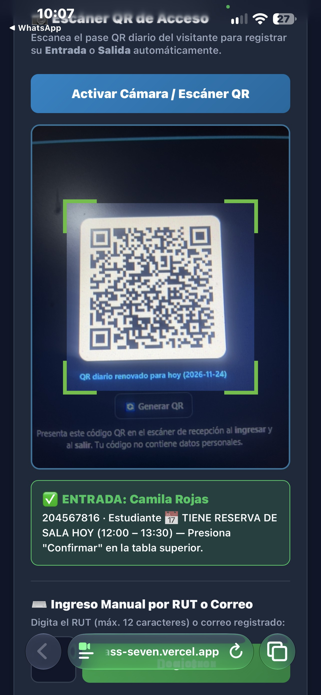
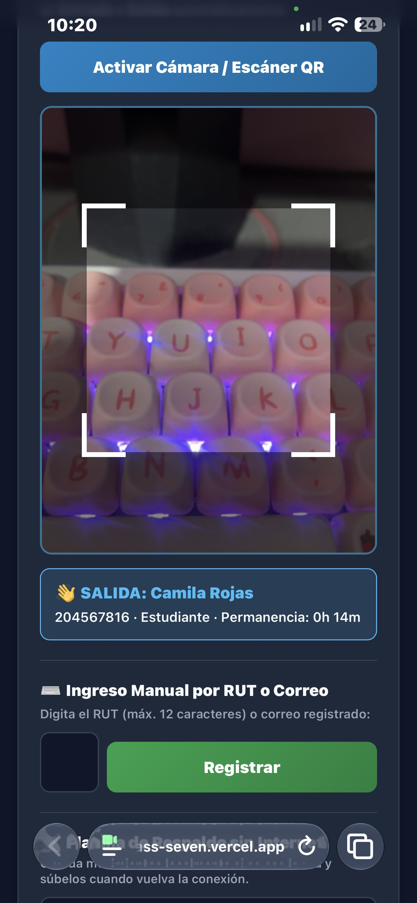
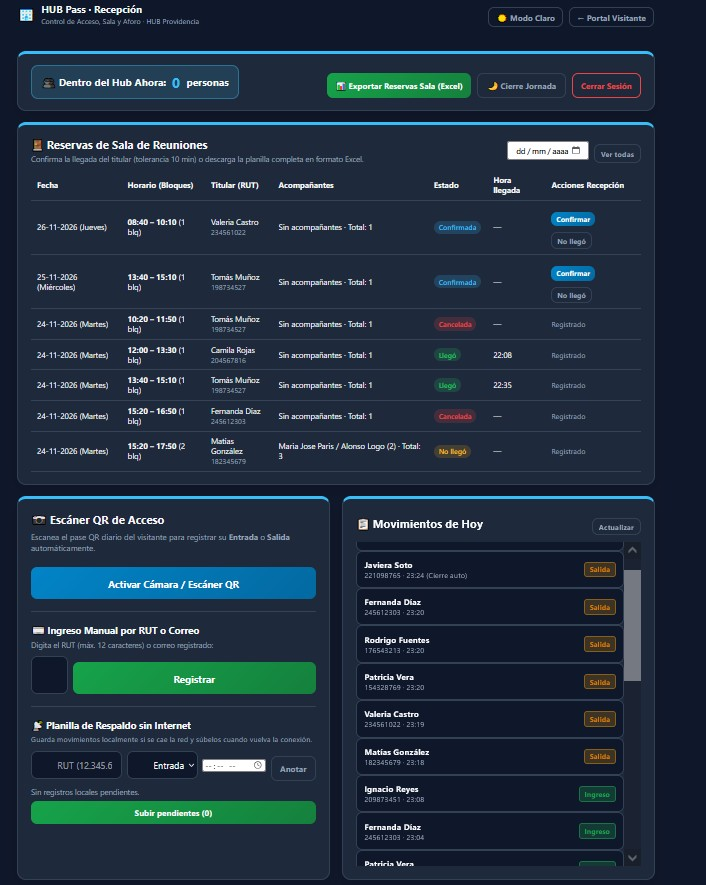
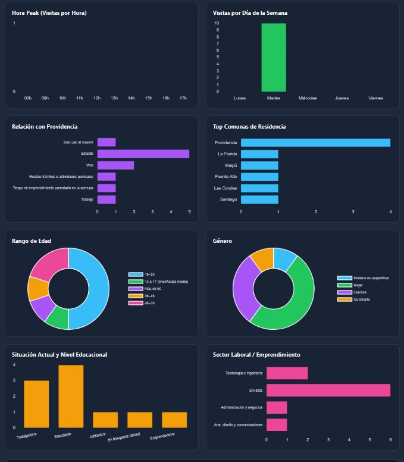

# S12 — Semana del 24 de noviembre al 1 de diciembre de 2026

## 📅 Fecha
24 de noviembre de 2026

## 🏫 Trabajo realizado en clase

### 📝 Actividades
En esta sesión se revisaron las indicaciones para el póster de la Feria Capstone, que se entrega el 25 de noviembre a las 12:00. El póster debe incluir un espacio con la validación del prototipo, por lo que el equipo decidió hacer una prueba completa de la página esa misma noche.

### 🧠 Aprendizajes
- Validar no es solo mostrar que la página funciona: hay que dejar registro de qué se probó, qué falló y cómo se corrigió.
- Probar el circuito completo con perfiles distintos permite encontrar errores que no aparecen al probar cada función por separado.

## 🏠 Trabajo realizado fuera de clases

### Acuerdos
**Desarrollo de la página (Benjamín)**
- Benjamín terminó la página de recepción y la de administración, ambas protegidas con contraseña.
- Recepción permite escanear el QR con la cámara del celular, registrar entradas y salidas por RUT, confirmar la llegada a la sala o marcar "No llegó", ver los movimientos del día, usar una planilla sin internet y hacer el cierre de jornada.
- Administración muestra el dashboard de indicadores (personas dentro, visitas por día, hora peak, permanencia, nuevos vs recurrentes, perfil de los usuarios y uso de la sala) y permite descargar en Excel los usuarios y las reservas.
- Durante la validación, Benjamín corrigió los errores en el momento.

**Validación del prototipo (Amanda)**
- Amanda diseñó y realizó la validación: creó 10 usuarios de prueba con perfiles distintos y ejecutó 34 casos de prueba sobre el registro, el acceso con QR, la recepción y la reserva de sala.
- Se respaldó y se limpió la base de datos antes de empezar.
- La prueba se hizo fuera del horario del Hub, así que la restricción de horario se desactivó temporalmente.
- Amanda registró los resultados y las evidencias, y actualizó el póster con la validación y los logos.

**Decisiones sobre la página**
- La sala se puede reservar solo de lunes a viernes, hasta el viernes de la semana siguiente, con una reserva por persona al día.
- Las personas de 14 años o más pueden reservar la sala.
- Género con opciones únicas: Mujer, Hombre, No binario y Prefiero no especificar.
- Se usará solo RUT como identificador (se saca "pasaporte").
- Los datos del apoderado para 14 a 17 años quedarán opcionales o se sacarán (Ley 21.719).
- La verificación del correo se simula con un botón; en la versión real llegará un enlace al correo.

## 📌 Avances obtenidos
- Página de recepción y administración terminadas y publicadas.
- Validación completa: **31 de 34 pruebas superadas** (Registro y cuenta 9/9, Reserva de sala 12/13, Acceso QR y recepción 10/12).
- **5 errores corregidos durante la prueba:** "Mis Reservas" vacío, reservas en fin de semana, acompañantes que no se guardaban, fechas en hora UTC y error al crear un pase del día sin correo.
- Póster terminado, con la validación y los logos.

## ⚠️ Problemas o dificultades
- Se pueden reservar bloques de hoy que ya pasaron.
- Recepción puede marcar "Llegó" en una reserva de otro día.
- La planilla sin internet no subió una salida, que quedó como cierre automático.
- No existe un Excel de visitas (entradas, salidas y permanencia), solo de usuarios y reservas.
- En celular, algunos campos de recepción se ven angostos o en blanco.

## 📌 Tareas pendientes
- Entregar el póster el 25 de noviembre a las 12:00.
- Benjamín: corregir los 3 errores pendientes y repetir esas pruebas.
- Benjamín: agregar el botón "Exportar Visitas (Excel)".
- Benjamín: sacar "pasaporte", dejar opcional el apoderado y ajustar el mensaje de RUT inválido.
- Benjamín: volver a activar la restricción de horario.
- Medir tiempos con cronómetro (formulario actual del Hub vs. Hub Pass).
- Agregar la validación y sus limitaciones al informe final.

## 📷 Evidencias

**Entrada con QR en recepción (reconoce la reserva de sala)**

**Salida con tiempo de permanencia**

**Recepción: reservas de sala y movimientos del día**

**Dashboard de administración**

