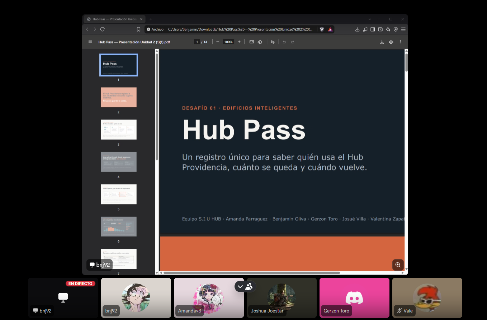

# S08 — Semana del 20 al 27 de octubre de 2026

## 📅 Fecha
20 de octubre de 2026

## 🏫 Trabajo realizado en clase

El equipo presentó al curso la versión definitiva de su propuesta: una aplicación
web de enrolamiento único con código QR, con registro de entrada y salida, base
de datos y dashboard. Se expuso también el alcance acordado, la prioridad del
registro por sobre otros módulos y el plan de trabajo de la Unidad 3.

### 💬 Retroalimentación de la profesora

La observación central fue que **el equipo tiene resuelta la parte tecnológica
pero no la parte de adopción**: no basta con construir el sistema, hay que
demostrar cómo se logra que las personas efectivamente lo usen. Los puntos
planteados fueron:

| Observación | Qué implica para el proyecto |
|---|---|
| Revisar el pilotaje | Definirlo con fechas, duración, participantes y criterios de éxito |
| Revisar el costo | Incorporar al informe una estimación explícita de costos |
| Ver la visualización | Mostrar cómo se ve el dashboard, no solo enumerar sus indicadores |
| Ver cómo publicitarlo | Diseñar la estrategia de difusión de la solución |
| Al Hub va siempre la misma gente | Considerar la recurrencia del público en el diseño |
| Lo ideal es conectarlo a la página oficial del Hub | Plantear la integración como horizonte de la solución |
| Hacer folletos sobre registrar la salida | Resolver el marcaje de salida por la vía comunicacional |

### 🧠 Aprendizajes

- Una propuesta no se evalúa solo por su solución técnica. La pauta del curso lo
  dice explícitamente: hay que explicar quién la usará, bajo qué condiciones,
  quién la operará y cómo se sostiene en el tiempo.
- La observación sobre que al Hub asiste siempre el mismo público, planteada
  como dificultad, resultó ser un argumento a favor del enrolamiento único: si
  los usuarios son recurrentes, registrarse una sola vez rinde mucho más. Además
  convierte la recurrencia en un indicador de gestión, porque si los datos
  confirman que no llega público nuevo, eso es información que hoy el Hub no tiene.
- El marcaje de salida, que es el supuesto más frágil de la propuesta, no se
  resuelve con tecnología sino con señalética, folletos y la solicitud del código
  por parte de recepción.

## 📢 Indicaciones para la entrega de la Unidad 2

El 25 de octubre la profesora comunicó que la entrega de la Unidad 2 se realiza
el martes 27 de octubre y comprende:

1. **Informe de avance**, en la plantilla publicada en la plataforma, completando
   los apartados que no corresponden a la entrega final.
2. **Presentación oral de máximo 10 minutos**, en formato pitch, con participación
   de todos los integrantes, apoyada en una presentación.

Se publicaron además las rúbricas de evaluación del informe y de la presentación
oral.

## 🏠 Trabajo realizado fuera de clases

- Incorporación de la retroalimentación: diseño de la pantalla del dashboard,
  estrategia de adopción, definición del pilotaje con plazos y criterios, y
  estimación de costos.
- Elaboración del informe de avance en la plantilla de la plataforma.
- Preparación de la presentación de 10 minutos, con reparto de las láminas entre
  los cinco integrantes y control de tiempos.
- Revisión del informe contra ambas rúbricas y ajuste de los apartados con menor
  desarrollo.

### 👥 Reunión de equipo — 26 de octubre

Se tomaron las siguientes decisiones de diseño, que quedan incorporadas al informe:

| Decisión | Fundamento |
|---|---|
| El código QR no contiene datos personales, solo un identificador interno | Si alguien fotografía la pantalla no obtiene información de la persona |
| El código se mantiene fijo durante el prototipo | Su renovación periódica se documenta como mejora posterior, ya que complica el uso de quien no tiene conexión en la entrada |
| Los campos de identificación son obligatorios | Sin ellos no existe identidad persistente ni es posible distinguir visitantes nuevos de recurrentes |
| Los campos de caracterización deben responderse, pero incluyen la alternativa "prefiero no responder" | Evita que el formulario quede en blanco sin obligar a nadie a revelar información; la tasa de no respuesta pasa a ser un indicador |
| El acceso al edificio nunca queda condicionado a entregar datos | Quien no desee enrolarse es registrado en recepción mediante su RUT e ingresa igual |
| La persona puede consultar y modificar sus datos en cualquier momento | Garantiza el derecho de rectificación y mantiene la información actualizada |

También se incorporaron al informe tres apartados que estaban ausentes: las
alternativas consideradas y los criterios de elección, la factibilidad técnica,
económica, operativa y social, y la evaluación ética.

## 📌 Avances obtenidos
- Propuesta definitiva presentada al curso y retroalimentada por la profesora.
- Diseño de la pantalla del dashboard, que era el principal vacío señalado.
- Estrategia de adopción definida: integración con la página oficial del Hub,
  señalética y folletos de salida, solicitud del código en recepción y correos
  automáticos de confirmación.
- Pilotaje definido con duración, lugar, franja horaria e indicadores.
- Informe de avance y presentación oral preparados para la entrega del 27.

## ⚠️ Problemas o dificultades
- El informe presentaba vacíos detectados al contrastarlo con la rúbrica: faltaba
  la evaluación ética, la factibilidad no estaba desarrollada y las alternativas
  evaluadas aparecían dispersas en distintos apartados.
- El costo de los folletos y la señalética sigue sin cotizar, por lo que figura
  como estimación en el informe.

## 📌 Tareas pendientes
- [ ] Cotizar la impresión de folletos y señalética
- [ ] Unificar los responsables de la semana 4 del cronograma entre el informe y la presentación
- [ ] Ensayar la presentación completa controlando los 10 minutos
- [ ] Actualizar el índice automático del informe antes de entregarlo

## 📷 Evidencias

[📄 Informe Avance — propuesta seleccionada (WORD)](evidencias/S07/Informe_Avance.docx)

[📄 Hub Pass Presentacion - propuesta seleccionada (PTT)](evidencias/S07/Hub_Pass.pptx)

**Foto del equipo en llamada**

