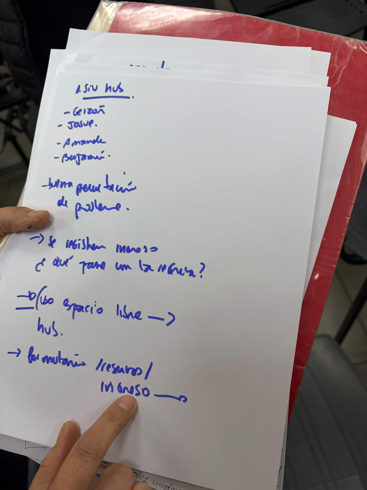
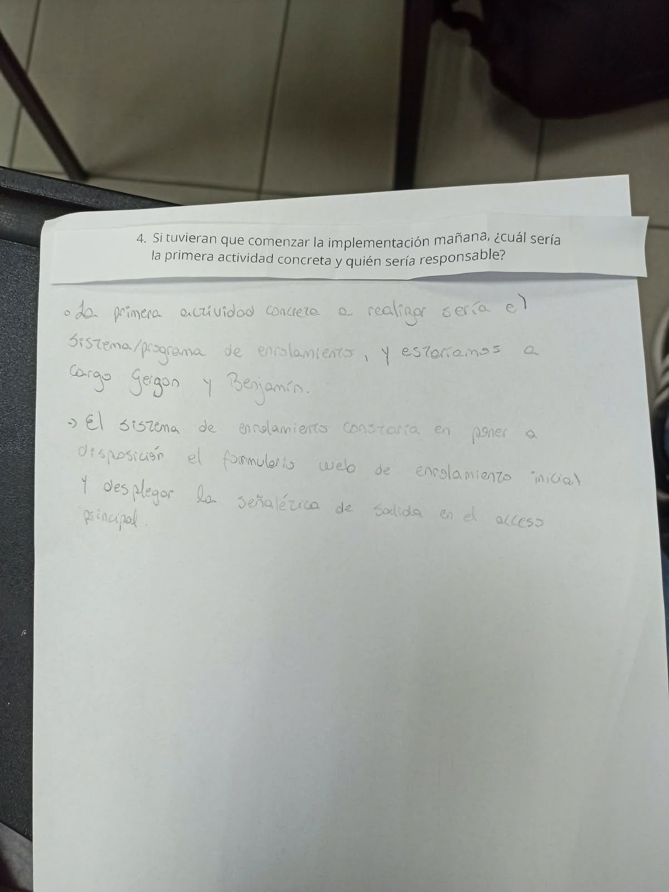

# S08 — Semana del 27 de octubre al 3 de noviembre de 2026

## 📅 Fecha
27 de octubre de 2026

## 🏫 Trabajo realizado en clase

### 📝 Actividades
En esta sesión el equipo entregó el informe de avance y realizó la presentación oral de la Unidad 2, con la participación de los cinco integrantes.

### 📢 Indicaciones de la profesora para la semana
- No considerar la asistencia a charlas dentro del proyecto.
- Enfocarse solo en la entrada al cowork y en la reserva de la sala de reuniones.

### 🧠 Aprendizajes
- El problema ya no se plantea como "cuatro registros" (Luma, BIForm, Excel y cuaderno), porque esos correspondían a charlas. Ahora son dos procesos separados: el formulario QR de entrada al cowork y la reserva de sala que se gestiona en recepción.
- Incluir la reserva de sala le da a las personas una razón concreta para crear su cuenta en Hub Pass.

## 🏠 Trabajo realizado fuera de clases

### Acuerdos
**Reserva de sala (entra al alcance desde ya)**
- La reserva se hace desde la cuenta de Hub Pass; el QR queda solo para entrada y salida.
- La persona elige el día y el bloque horario, e indica cuántas personas usarán la sala (máximo 4).
- Se propone que cada reserva dure 1 hora y 30 minutos.
- Solo quien reserva necesita cuenta; de los acompañantes se registra solo su nombre.
- Antes de la hora llega un correo de recordatorio para confirmar o cancelar.
- Al llegar, la persona confirma en recepción, donde ven las reservas del día, y le indican que pase a la sala.
- Si no llega a tiempo, la reserva se libera, igual que la regla actual del Hub.

**Campaña de difusión**
- Tres folletos: escanear el QR al entrar y al salir (en la entrada), "no olvides marcar tu salida" (junto a la salida) y la invitación a crear la cuenta para reservar la sala con anticipación.
- Proponer al Hub publicar historias en su Instagram con el enlace a la página.
- Correo de bienvenida con el QR y una explicación de la reserva.

**Meta del proyecto**
Si el piloto muestra que las personas se inscriben y usan el sistema, la idea es que el Hub lo integre a su página oficial.

## 📌 Avances obtenidos
- Actualizamos el informe de avance para que sea coherente con el nuevo enfoque: resumen, problema (se agregó una quinta falla sobre la reserva de sala), objetivos, descripción, alcance, componentes, modelo de datos (nueva entidad "reserva"), prototipo, validación, cronograma y riesgos.
- Las secciones 6.2 a 7 no se incluyeron porque la plantilla las marca para el informe final.
- Realizamos la coevaluación del equipo.

## ⚠️ Problemas o dificultades
- La participación no es pareja: cuesta que los integrantes se ofrezcan para tareas sin que se las asignen.
- Los responsables de la Semana 4 no coinciden entre el informe (Amanda y Valentina) y el PPT (Benjamín y Valentina).

## 📌 Tareas pendientes
- Unificar los responsables de la Semana 4.
- Cotizar la impresión de los folletos.
- Iniciar la Unidad 3 con el modelo de datos y la base de datos, incluyendo la entidad reserva.
- Hacer una prueba interna de Hub Pass entre nosotros antes del piloto.
- Que cada integrante tome un módulo del prototipo y muestre su avance en la reunión de los lunes.

## 📷 Evidencias

**Retroalimentación de la profesora**

**Preguntas sobre la presentación**

