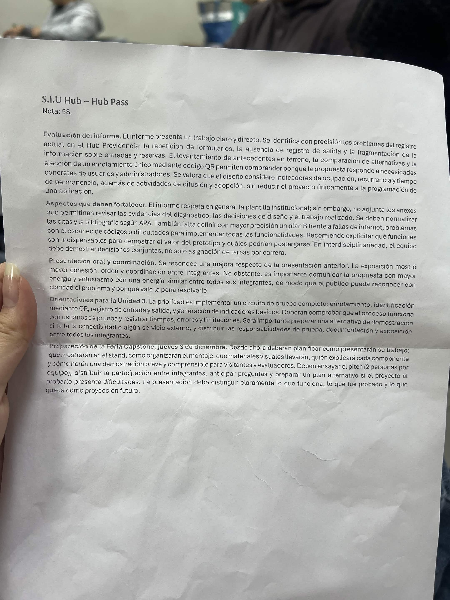
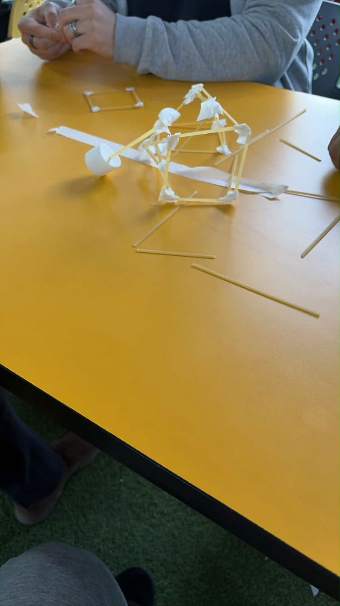
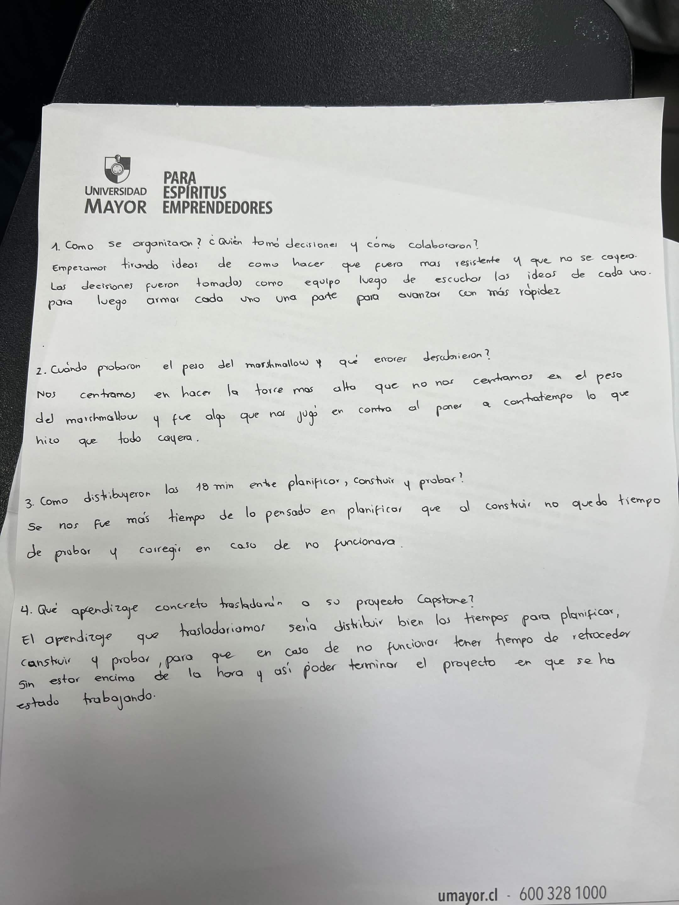
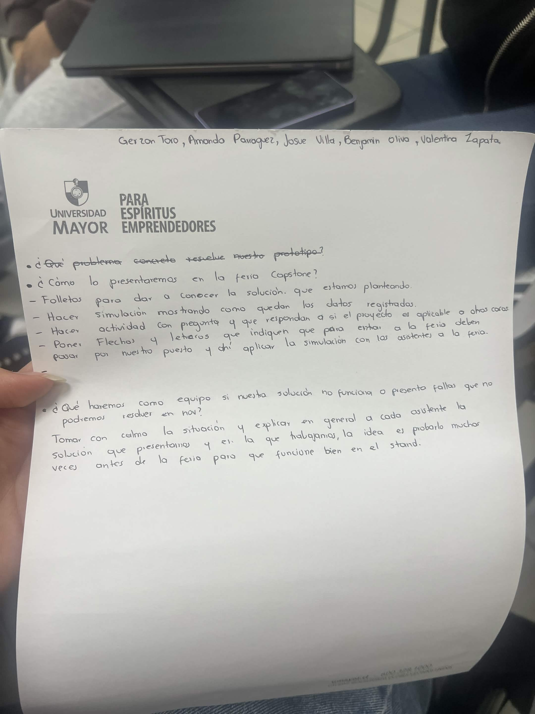

# S09 — Semana del 3 al 10 de noviembre de 2026

## 📅 Fecha
3 de noviembre de 2026

## 🏫 Trabajo realizado en clase

### 📝 Actividades
En esta sesión la profesora entregó la retroalimentación del informe de avance y de la presentación oral de la Unidad 2. El equipo obtuvo nota 5,8 y podrá volver a subir el informe con las correcciones.

Luego se realizó una actividad grupal: construir, en 18 minutos, la torre más alta posible con tallarines y cinta, capaz de sostener un marshmallow en la punta. Participó todo el equipo; Amanda se sumó más tarde. El equipo no ganó, porque la torre se cayó al poner el marshmallow.

Por último, la profesora planteó preguntas sobre cómo presentaremos el proyecto en la Feria Capstone.

### 📋 Ejercicio en clase — respuestas del equipo

**Actividad de la torre con marshmallow**

**¿Cómo se organizaron? ¿Quién tomó decisiones y cómo colaboraron?**
Empezamos tirando ideas de cómo hacer que la torre fuera más resistente y no se cayera. Las decisiones se tomaron como equipo después de escuchar las ideas de cada uno, y luego cada uno armó una parte para avanzar más rápido.

**¿Cuándo probaron el peso del marshmallow y qué errores descubrieron?**
Nos centramos en hacer la torre más alta y no en el peso del marshmallow. Eso nos jugó en contra: al ponerlo a última hora, todo se cayó.

**¿Cómo distribuyeron los 18 minutos entre planificar, construir y probar?**
Se nos fue más tiempo del pensado en planificar, y al construir no quedó tiempo para probar y corregir si no funcionaba.

**¿Qué aprendizaje concreto trasladarán a su proyecto Capstone?**
Distribuir bien los tiempos para planificar, construir y probar, para que, si algo no funciona, tengamos tiempo de retroceder sin estar encima de la hora y así poder terminar el proyecto.

**Preguntas sobre la Feria Capstone**

**¿Cómo lo presentaremos en la Feria Capstone?**
- Folletos para dar a conocer la solución que estamos planteando.
- Una simulación que muestre cómo quedan los datos registrados.
- Una actividad con preguntas, para que los asistentes respondan si el proyecto es aplicable a otras cosas.
- Flechas y letreros que indiquen que, para entrar a la feria, deben pasar por nuestro puesto, y ahí aplicar la simulación con los asistentes.

**¿Qué haremos como equipo si nuestra solución no funciona o presenta fallas que no podremos resolver en noviembre?**
Tomar con calma la situación y explicar a cada asistente, en general, la solución que presentamos y en la que trabajamos. La idea es probarla muchas veces antes de la feria para que funcione bien en el stand.

### 🧠 Aprendizajes
- Probar con el peso real desde el principio, y no solo al final. En Hub Pass eso significa probar el circuito completo con usuarios antes del piloto y de la feria.
- Reservar tiempo para probar y corregir dentro de la planificación de la Unidad 3.

### 📢 Indicaciones de la profesora para la semana
Retroalimentación del informe y la presentación:
- **Lo valorado:** el informe identifica con precisión los problemas del registro actual (repetición de formularios, ausencia de salida y fragmentación entre entradas y reservas). También se valoraron el levantamiento en terreno, la comparación de alternativas, los indicadores y las actividades de difusión y adopción.
- **A fortalecer:** adjuntar los anexos con las evidencias, normalizar citas y bibliografía según APA, definir un plan B ante fallas de internet, de escaneo o de funcionalidades, explicitar qué funciones son indispensables y cuáles pueden postergarse, y demostrar decisiones conjuntas entre carreras, no solo asignación de tareas.
- **Presentación:** mejoró respecto de la anterior en cohesión y orden, pero falta comunicar con más energía y de forma pareja entre todos.
- **Unidad 3:** priorizar un circuito de prueba completo (enrolamiento, QR, entrada y salida, e indicadores básicos), probar con usuarios registrando tiempos, errores y limitaciones, preparar una alternativa si falla la conectividad o algún servicio externo, y repartir prueba, documentación y exposición entre todos.
- **Feria Capstone, jueves 3 de diciembre:** planificar el stand, el montaje, los materiales visuales, quién explica cada componente y una demostración breve. El pitch es de 2 personas por equipo. Hay que anticipar preguntas, tener un plan alternativo y distinguir lo que funciona, lo probado y la proyección futura.

## 🏠 Trabajo realizado fuera de clases

### Acuerdos
**Lector QR (Electrónica)**
- Josué intentó construir un lector QR con ESP32 y el módulo GM65, pero no logró que escaneara los códigos.
- Se decidió que el escaneo en recepción se hará con la cámara de un celular desde el navegador, que era el plan B definido en el informe.

**Avance de la página web**
- El 5 de noviembre, Josué, Gerzon y Benjamín se reunieron por Discord y avanzaron en el frontend.
- La página está publicada en https://hubpass-seven.vercel.app/ (aún en desarrollo).
- Ya tiene: registro e inicio de sesión con RUT, código QR personal, pase de visitante del día, historial de accesos, reserva de sala y edición del perfil.
- Falta: dashboard de indicadores y pantalla de escaneo para recepción.

**Roles para la Feria Capstone**
- Valentina: encargada del póster (estructura por confirmar).
- Josué, Gerzon y Benjamín: desarrollo de la página web.
- Amanda: revisión y visto bueno del avance, y decoración del stand para que sea llamativo.
- Amanda y Gerzon: presentarán el pitch.
  
**Reserva de sala**
- De los acompañantes se registra solo su nombre, sin crear cuenta. Así recepción sabe quiénes usarán la sala.
- Los acompañantes no forman parte de la caracterización, porque no tienen cuenta.

## 📌 Avances obtenidos
- Retroalimentación recibida y revisada punto por punto contra el informe.
- Definida la forma de presentar Hub Pass en la Feria Capstone.
- Definido el rol de Electrónica en el prototipo: el lector QR físico.
- Primera versión de la página web publicada, con registro, QR, pase del día, historial y reserva de sala.

## ⚠️ Problemas o dificultades
- En la actividad de la torre se nos fue el tiempo planificando y no alcanzamos a probar.
- Falta la lista de materiales del lector y la pieza por comprar.
- El lector QR físico no logró escanear los códigos, por lo que se reemplazó por la cámara del celular.

## 📌 Tareas pendientes
- Corregir el informe según la retroalimentación y volver a subirlo.
- Construir el dashboard de indicadores.
- Crear la pantalla de escaneo para recepción con la cámara del celular.
- Ajustar la página al informe: sacar o marcar como futura la sección de eventos y completar los campos de caracterización.
- Valentina: averiguar el formato del póster de la feria.

## 📷 Evidencias

**Retroalimentación de la profesora (informe y presentación de la Unidad 2)**

**Actividad: torre de tallarines con marshmallow**

**Respuestas del equipo sobre la actividad de la torre**

**Preguntas sobre la presentación en la Feria Capstone**

